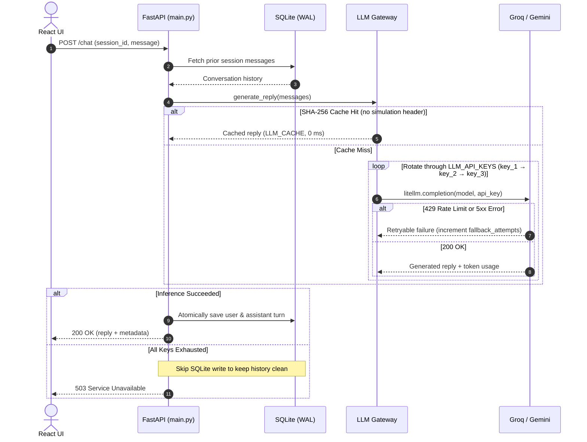
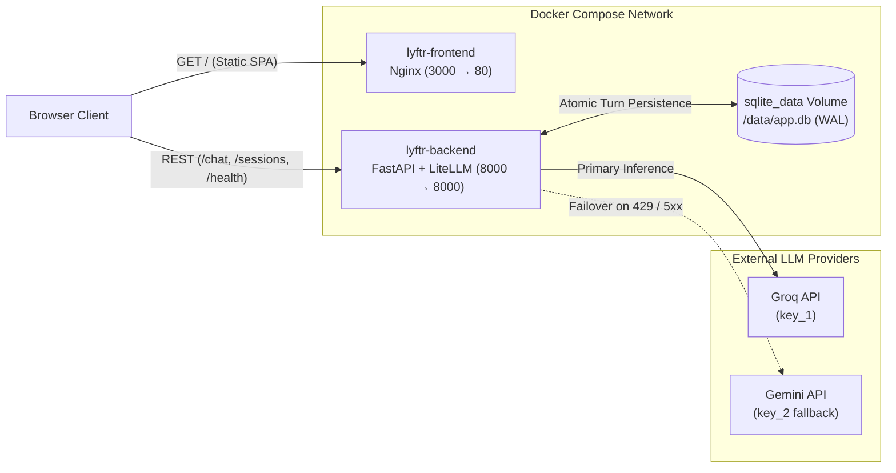

# Lyftr AI — Resilient Multi-Turn Chatbot

Full-stack AI chat service built with **FastAPI**, **LiteLLM**, **SQLite (WAL mode)**, and **React (Vite)** featuring automatic cross-provider API key failover, LiteLLM built-in response caching, atomic SQLite turn persistence, and multi-stage Docker deployment.

## Live URLs

- **Frontend UI:** `http://localhost:3000`
- **Backend API:** `http://localhost:8000`
- **Interactive API Docs:** `http://localhost:8000/docs`
- **Health Check:** `http://localhost:8000/health`

## Run locally

### Option A: Docker Compose (`Makefile`)

1. Copy `.env.example` to `.env` and add your API keys:
   ```bash
   cp .env.example .env
   ```
2. Build and start both containers:
   ```bash
   make up
   ```
3. Stop containers when finished (retains SQLite volume):
   ```bash
   make down
   ```

### Option B: Native Development Servers

**Backend (`backend/`):**
```bash
cd backend
python -m venv venv
source venv/bin/activate  # Windows: .\venv\Scripts\Activate.ps1
pip install -r requirements.txt
uvicorn main:app --reload --port 8000
```

**Frontend (`frontend/`):**
```bash
cd frontend
npm install
npm run dev
```

## Design decisions


- **LiteLLM Built-In Cache (`litellm.cache = Cache()`):** Uses LiteLLM's native in-memory cache and inspects `response._hidden_params["cache_hit"]` to distinguish `LLM_CACHE` from `LIVE_INFERENCE`. When a reply is cached under a fallback model after failover, cache lookups check across all configured pool models so repeat prompts still hit immediately without wasting a primary-model call.
- **Prefix-Based Cross-Provider Key Rotation:** Keys in `LLM_API_KEYS` are mapped to safe identifiers (`key_1`, `key_2`, `key_3`) and routed automatically by prefix (`gsk_*` → `groq/openai/gpt-oss-20b`, `AIza*`/`AQ.*` → `gemini/gemini-3.8-flash`) so raw secrets are never exposed in responses.
- **Atomic Turn Persistence:** `database.save_turn()` commits session metadata and the `(user, assistant)` message pair to SQLite (WAL mode) only after a `200 OK` inference response, guaranteeing `422` validation errors and `503` provider outages never leave orphaned turns in history.
- **Ephemeral Client Sessions:** Each page load generates a fresh UUID session in memory while keeping historical threads retrievable via `GET /sessions/{session_id}/messages`.


## Request & Failover Flow




## Container & Persistence Topology


## Verification

1. **Health endpoint:**
   ```bash
   curl http://localhost:8000/health
   ```
2. **Live inference & LiteLLM cache hit:**
   ```bash
   curl -X POST http://localhost:8000/chat \
     -H "Content-Type: application/json" \
     -d '{"session_id":"verify-1","message":"Reply with OK"}'

   curl -X POST http://localhost:8000/chat \
     -H "Content-Type: application/json" \
     -d '{"session_id":"verify-2","message":"Reply with OK"}'
   ```
3. **Simulated key & cross-provider failover:**
   ```bash
   curl -X POST http://localhost:8000/chat \
     -H "Content-Type: application/json" \
     -H "X-Simulate-Failure: key_1=429,key_2=500" \
     -d '{"session_id":"verify-3","message":"Explain failover in one sentence"}'
   ```
4. **Unknown session `404` & restart persistence:**
   ```bash
   curl -i http://localhost:8000/sessions/unknown-id/messages
   docker compose restart backend
   curl http://localhost:8000/sessions/verify-1/messages
   ```
5. **Automated test suite:**
   ```bash
   pytest -v backend/test_main.py
   ```

## Setup Used

- **Backend:** Python 3.12+, FastAPI, Uvicorn, LiteLLM (`litellm.cache = Cache()`), Pydantic v2, SQLite (WAL mode)
- **Frontend:** React 19, Vite, `react-markdown`, CSS custom properties
- **Infrastructure:** Multi-stage Dockerfiles (`python:3.12-slim`, `node:20-alpine` → `nginx:1.27-alpine`), Docker Compose with named `/data` volume, `Makefile`

## Bonus

- **Per-session `system_prompt` override:** `POST /chat` accepts an optional `system_prompt` field (up to 4000 chars), persists it per `session_id` in SQLite, and applies it across subsequent turns in that session without polluting the visible message history.
- **Failure-simulation isolation:** Requests carrying `X-Simulate-Failure` pass `cache={"no-cache": True, "no-store": True}` to LiteLLM so chaos tests never read from or poison the live response cache.
- **Automated `pytest` suite:** 8 unit and integration tests covering `/health`, `404` session lookups, `422` input length bounds, same-provider and cross-provider key rotation, LiteLLM cache hits, and atomic failure handling.