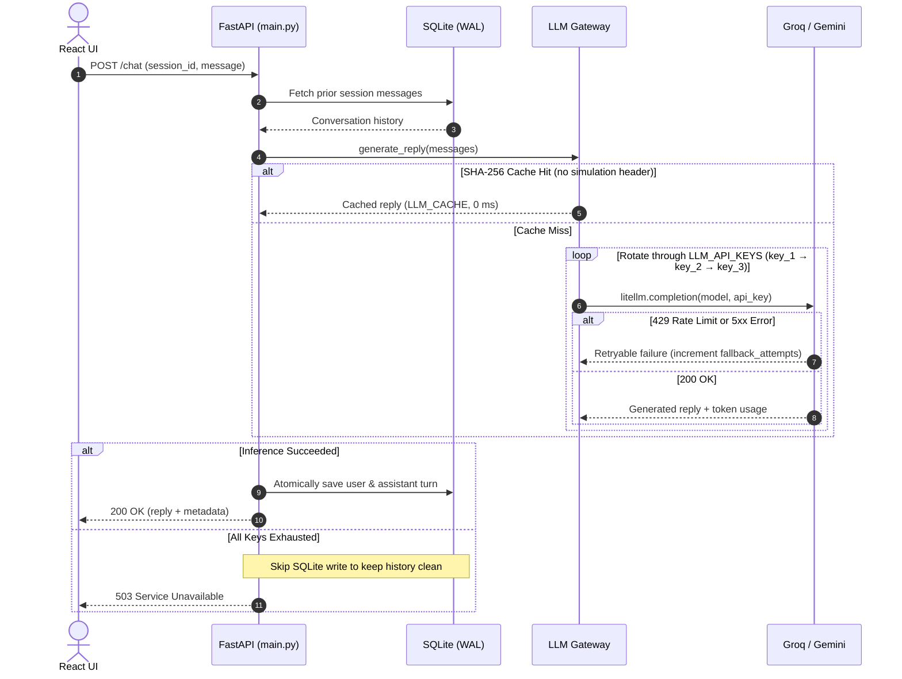
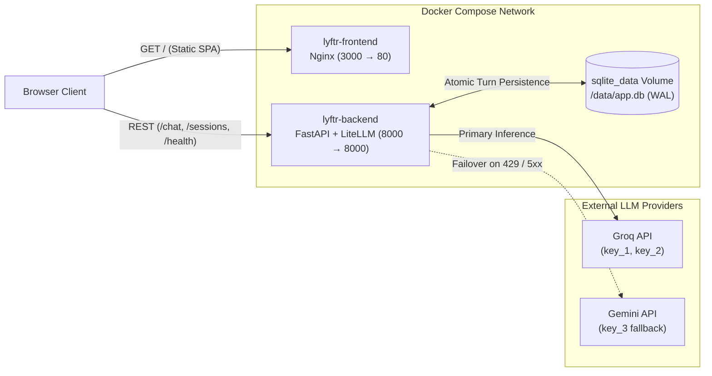

# Lyftr AI — Resilient Multi-Turn Chatbot

Full-stack AI chat application built with **FastAPI**, **LiteLLM**, **SQLite (WAL mode)**, and **React (Vite)**, featuring automatic cross-provider API key failover, deterministic SHA-256 response caching, persistent session history, and multi-stage Docker deployment.

## Architecture

- **Backend (`backend/`)**: FastAPI service exposing `/health`, `/chat`, `/sessions`, and `/sessions/{session_id}/messages`.
- **LLM Gateway (`backend/llm_gateway.py`)**: Rotates across `LLM_API_KEYS` (`key_1`, `key_2`, ...) on HTTP `429` or `5xx` errors, switches provider models automatically by key prefix, and caches identical conversation states in memory (`LLM_CACHE`).
- **Persistence (`backend/database.py`)**: SQLite database in WAL mode storing chat turns atomically only after successful inference.
- **Frontend (`frontend/`)**: Responsive React interface with collapsible chat history sidebar, Markdown rendering, active model badge, and telemetry pills.
## Request & Failover Flow




## Quick Start (Docker Compose)


## Container & Persistence Topology



1. Stop any local Uvicorn or Vite dev servers occupying ports `8000` or `3000`.
2. Copy `.env.example` to `.env` and add your API keys:
   ```bash
   cp .env.example .env